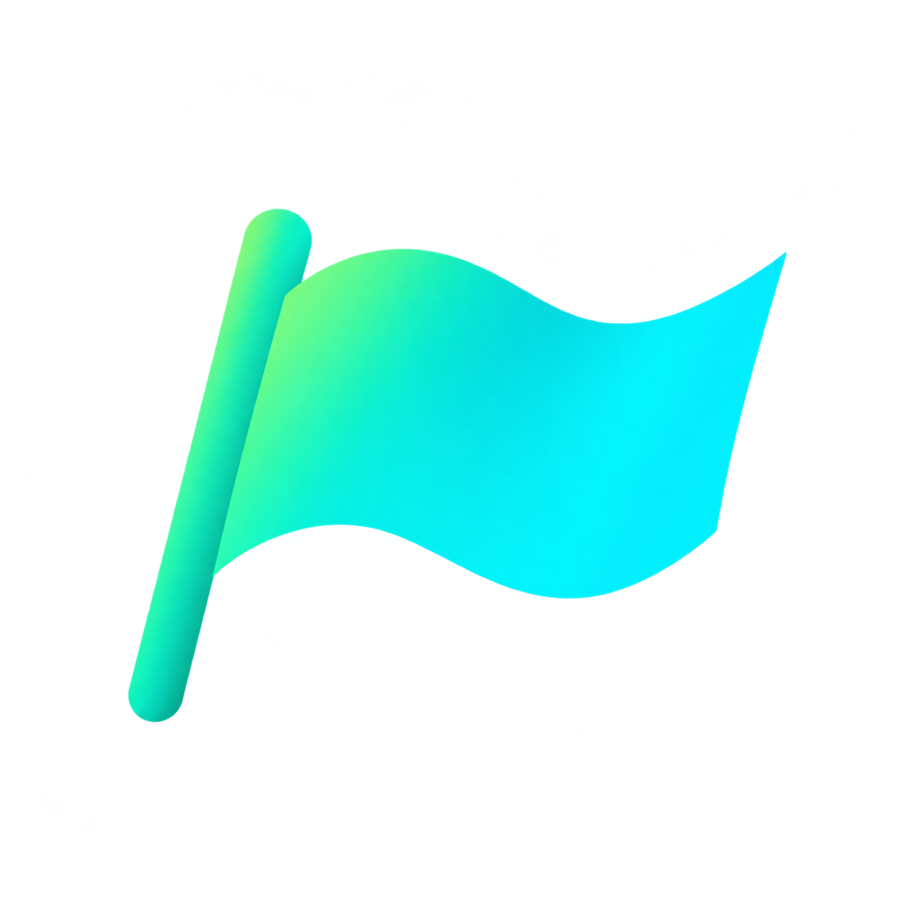

<div align="center">
  
  <h1>🏳️ GuacamoleGH Flags — Country Flag Quiz</h1>
  <p><strong>Quiz interactivo bilingüe de banderas de los 196 países oficiales del mundo para el homelab GuacamoleGH</strong></p>
  <p>
    
    
    
    
    
  </p>
</div>

---

## 📑 Índice

- [📌 Sobre el proyecto](#about)
- [🎮 Modos de Juego y Continentes](#gamemodes)
- [🌍 Criterio y Listado Oficial de los 196 Países](#countries)
- [⚡ Diseño Horizontal Minimalista y Ergonomía](#design)
- [🌓 Modo Claro y Modo Oscuro](#themes)
- [🌐 Soporte Bilingüe (Español / English)](#i18n)
- [🧠 Autocompletado Inteligente y Validación de Alias](#validation)
- [👤 Sistema de Cuentas, Rankings y Perfiles](#users)
- [🛡️ Anti-Trampas Heurístico](#anticheat)
- [🏠 Despliegue en Homelab (Docker Compose)](#homelab)
- [🛠️ Stack Tecnológico](#stack)
- [⚙️ Instalación y Desarrollo Local](#development)
- [🧪 Pruebas y Calidad](#testing)
- [📄 Licencia](#license)

---

<a name="about"></a>
## 📌 Sobre el proyecto

**GuacamoleGH Flags** es una aplicación web interactiva diseñada para desafiar el conocimiento geográfico mundial reconociendo las **196 banderas oficiales del planeta** en el menor tiempo posible.

Diseñada bajo la identidad visual tecnológica del homelab GuacamoleGH (gama carbón `#0c0e12` con acentos verde neón `#00f59b` y turquesa digital `#00d9c4`), ofrece una experiencia ágil, horizontal y fluida tanto en navegadores de escritorio como en dispositivos táctiles móviles.

---

<a name="gamemodes"></a>
## 🎮 Modos de Juego y Continentes

Permite jugar el desafío completo o seleccionar por regiones:
- **Mundo entero**: Las 196 banderas oficiales del planeta.
- **Europa**: 46 países europeos.
- **Asia**: 47 países asiáticos.
- **África**: 54 países africanos.
- **América**: 35 países americanos.
- **Oceanía**: 14 países de Oceanía.

Cada modo cuenta con su propia tabla de clasificación global en el **Leaderboard**.

---

<a name="countries"></a>
## 🌍 Criterio y Listado Oficial de los 196 Países

El catálogo de 196 países del quiz se fundamenta en el estándar internacional más extendido para juegos de banderas y estados soberanos:

1. **193 Estados miembros de las Naciones Unidas (ONU)**.
2. **2 Estados observadores permanentes de la Asamblea General de la ONU:**
   - **Ciudad del Vaticano** (Santa Sede / `va`).
   - **Estado de Palestina** (`ps`).
3. **1 Estado con soberanía de facto reconocida internacionalmente:**
   - **Taiwán** (República de China / `tw`) y reconocimiento de **Kosovo** (`xk`).

Cada país dispone de:
- Identificador inmutable ISO-3166-1 alfa-2.
- Bandera vectorial local SVG optimizada (proporción 3:2, sin deformación y 100% offline).
- Nombre oficial, capital y continente en español e inglés.
- Diccionario exhaustivo de alias oficiales y abreviaciones compuestas reconocidas.

---

<a name="design"></a>
## ⚡ Diseño Horizontal Minimalista y Ergonomía

A diferencia de los quizzes tradicionales verticales de una sola columna, **GuacamoleGH Flags** maximiza el espacio horizontal:
- **Cuadrícula adaptativa amplia**: 6 a 8 columnas de banderas en escritorio, 4 a 5 en portátiles, 3 en tablets y 2 en móviles.
- **Barra de control centralizada**: Con vista previa amplia de la bandera activa, botones de navegación anterior/siguiente, temporizador automático desde la primera pulsación y campo de entrada centrado geométricamente.
- **Enfoque automático al siguiente país**: Al acertar una bandera, se marca en verde con el nombre del país y el foco salta a la siguiente bandera pendiente.
- **Libertad de resolución**: Responde en cualquier orden haciendo clic en cualquier bandera de la cuadrícula o navegando con flechas.

---

<a name="themes"></a>
## 🌓 Modo Claro y Modo Oscuro

- **Selector con icono adaptativo**: Muestra una luna en modo claro (para alternar a oscuro) y un sol en modo oscuro (para alternar a claro).
- **Colores de alto contraste**:
  - En modo oscuro: Acentos neón, bordes ámbar para la bandera activa y verde para aciertos.
  - En modo claro: Fondo limpio, bandera activa resaltada en ámbar cálido (`#d97706` y `#fef3c7`), banderas acertadas en verde esmeralda profundo (`#059669` y `#ecfdf5`), y botón Start Quiz con texto blanco de alto contraste sobre verde esmeralda.

---

<a name="i18n"></a>
## 🌐 Soporte Bilingüe (Español / English)

El selector de idioma en la barra superior permite alternar instantáneamente entre:
- **Español (ES)**
- **English (EN)**

> **Regla de oro de continuidad:** Cambiar el idioma **nunca reinicia el progreso de la partida en curso**. El selector se bloquea durante una partida activa para garantizar la consistencia de la prueba.

---

<a name="validation"></a>
## 🧠 Autocompletado Inteligente y Validación de Alias

El motor de validación distingue estrictamente entre nombres simples y países compuestos para evitar falsos positivos:

### 1. Nombres Simples
- Requieren el nombre completo (ej: `España` o `Spain`).
- **No se permite autocompletado agresivo**: escribir `esp` o `Esp` **nunca** dará por buena a España.
- Tolerancia total a mayúsculas, minúsculas, espacios y tildes (`españa`, `espana`, `ESPAÑA`).

### 2. Países Compuestos (Atajos Inequívocos)
Aceptan nombres abreviados configurados tras pulsar Enter o confirmar:
- `Sao Tome` $\to$ **Santo Tomé y Príncipe** / **Sao Tome and Principe**
- `Macedonia` $\to$ **Macedonia del Norte** / **North Macedonia**
- `USA` / `EEUU` $\to$ **Estados Unidos** / **United States**
- `UK` $\to$ **Reino Unido** / **United Kingdom**
- `Emiratos` / `UAE` $\to$ **Emiratos Árabes Unidos** / **United Arab Emirates**
- `Holanda` / `Holland` $\to$ **Países Bajos** / **Netherlands**
- `Vaticano` / `Vatican` $\to$ **Ciudad del Vaticano** / **Vatican City**
- `Bosnia` $\to$ **Bosnia y Herzegovina**
- `Trinidad` $\to$ **Trinidad y Tobago**
- `Antigua` $\to$ **Antigua y Barbuda**
- `St Kitts` / `San Cristobal` $\to$ **San Cristóbal y Nieves**
- `St Vincent` / `San Vicente` $\to$ **San Vicente y las Granadinas**
- `St Lucia` $\to$ **Santa Lucía**
- `DR Congo` / `RD Congo` $\to$ **República Democrática del Congo**
- `Congo Brazzaville` $\to$ **República del Congo**
- `Dominicana` $\to$ **República Dominicana**

---

<a name="users"></a>
## 👤 Sistema de Cuentas, Rankings y Perfiles

- **Modo Invitado 100% Funcional**: Juega sin cuenta, mide tu tiempo y guarda tu récord local en `localStorage`.
- **Autenticación Soberana**: Registro e inicio de sesión con contraseñas cifradas mediante `bcryptjs` (salt rounds: 10) y sesiones JWT seguras. Admite puntos (`.`), guiones, guiones bajos y acentos en el nombre de usuario.
- **Rankings Globales (`#leaderboard`)**:
  - Tabla de mejores tiempos por modo de juego (Mundo o continentes).
  - Resolución determinista de empates por orden de consecución.
  - Posición y tiempo destacado del usuario conectado.
- **Perfil de Jugador (`#profile`)**:
  - Vista pública y privada editable.
  - Selector de avatares arcade (`🚩 Flag Master`, `🧭 Brújula`, `🌍 Globo`, `🗺️ Explorador`, `🦅 Halcón`, `🕹️ Arcade`).
  - Estadísticas: mejor tiempo por modo, partidas completadas, jugadas y porcentaje de acierto.
- **Historial de Partidas (`#history`)**:
  - Registro de todas las partidas finalizadas o abandonadas.
  - Filtro por completadas/abandonadas y ordenación por fecha o tiempo.

---

<a name="anticheat"></a>
## 🛡️ Anti-Trampas Heurístico

El backend Express valida estrictamente las puntuaciones antes de registrarlas en el leaderboard:
- Tiempos físicamente imposibles (< 25 segundos para 196 banderas) son rechazados automáticamente con código HTTP 400.
- Validación de correspondencia entre estado completado y aciertos exactos del modo.
- Las partidas incompletas o abandonadas se registran en el historial personal, pero nunca entran en la tabla de récords globales.

---

<a name="homelab"></a>
## 🏠 Despliegue en Homelab (Docker Compose)

Diseñado para desplegarse de forma soberana detrás de Traefik, Caddy o Nginx en el subdominio `flags.guacamolegh.es`.

```bash
docker compose up -d --build
```

- **Puerto por defecto:** `${PORT:-3095}:3000`
- **Healthcheck:** `GET http://localhost:3095/api/health`
- **Volumen persistente:** `./data:/app/data` (base de datos `flags.db` en SQLite con modo WAL y secreto de firma).

---

<a name="stack"></a>
## 🛠️ Stack Tecnológico

| Capa | Tecnología |
|---|---|
| **Frontend** | TypeScript 5, Vite 6, CSS3 Moderno (CSS Grid + Custom Properties) |
| **Backend API** | Node.js 22 LTS, Express, TypeScript (`tsx`) |
| **Base de Datos** | SQLite (`node:sqlite DatabaseSync`) en modo WAL |
| **Seguridad** | `bcryptjs` + JWT |
| **Testing** | Vitest + Happy-DOM (17 pruebas automatizadas) |
| **Contenedores** | Docker multi-stage + Docker Compose |

---

<a name="development"></a>
## ⚙️ Instalación y Desarrollo Local

```bash
# 1. Instalar dependencias
npm install

# 2. Iniciar servidor de desarrollo (backend + API)
npm run dev:all

# 3. Compilar producción y verificar tipos
npm run build

# 4. Ejecutar tests
npm test
```

---

<a name="testing"></a>
## 🧪 Pruebas y Calidad

El proyecto incluye 17 tests unitarios y de integración:
- `tests/validation.test.ts`: Verificación de los 196 países únicos, normalización de acentos, rechazo estricto de prefijos (`esp` $\ne$ `España`), alias y compuestos.
- `tests/api.test.ts`: Healthcheck, registro y login con bcrypt, anti-cheat, envío de récords, ranking global, perfiles públicos e historial.

---

<a name="license"></a>
## 📄 Licencia

MIT License — Copyright (c) 2026 [GuacamoleGH](https://github.com/GuacamoleGH).  
Construido con la metodología [dbv-specs-ops](https://github.com/davidbuenov/dbv-specs-ops).
